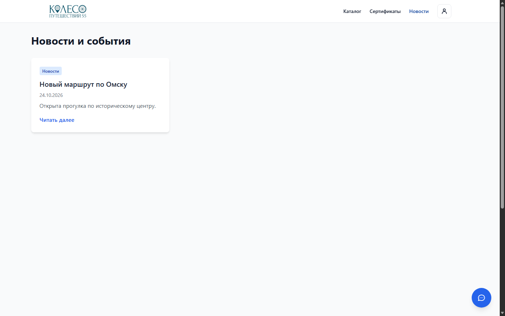
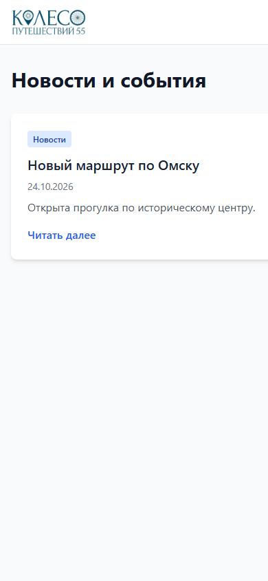

## Что изменено

- Django NewsArticle: черновик/публикация, дата, обложка, категория, миграция и Admin.
- Публичные `/api/news/` и `/api/news/{slug}/`: только опубликованные записи с наступившей датой, сортировка по дате, пагинация.
- Страница `/news` загружает API, показывает текст, состояния загрузки/ошибки/пустого списка и страницы.

## Критерии приёмки и ручная проверка

1. Выдать редактору `is_staff` и только права NewsArticle. Убедиться, что другие модели закрыты.
2. Создать черновик в Admin: в `/api/news/` и на `/news` он отсутствует.
3. Включить публикацию с текущей датой: запись появляется на сайте. Нажать «Читать далее» и проверить полный текст. Снять публикацию: запись исчезает.
4. Создать больше 12 записей и проверить переключение страниц.

## Проверки

- `python -m django test news --settings=news_test_settings`: 4 теста, OK (SQLite, изолированные настройки).
- `python -m django makemigrations news --check --dry-run --settings=news_test_settings`: изменений нет.
- `python -m django check --settings=news_test_settings`: ошибок нет.
- `npm run lint`: OK.
- `npm run build`: OK (предупреждение Vite о размере общего JS chunk).
- Браузер: `http://127.0.0.1:5173/news`, Edge, desktop 1440×900 и mobile 390×844; локальный тестовый ответ `/api/news/`, карточка без обложки. Скриншоты ниже.

## Ограничения

Полный `python manage.py check/test` не запустился: локально нет Celery и остальных зависимостей основного Django, Docker daemon недоступен. Скриншоты показывают страницу с локальным тестовым API; сквозная проверка с работающим Django остаётся для review.

